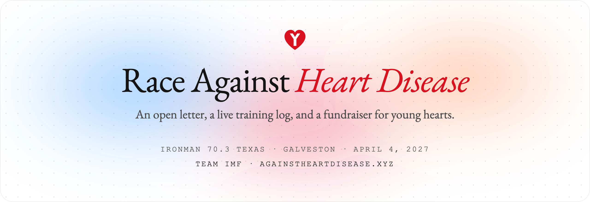
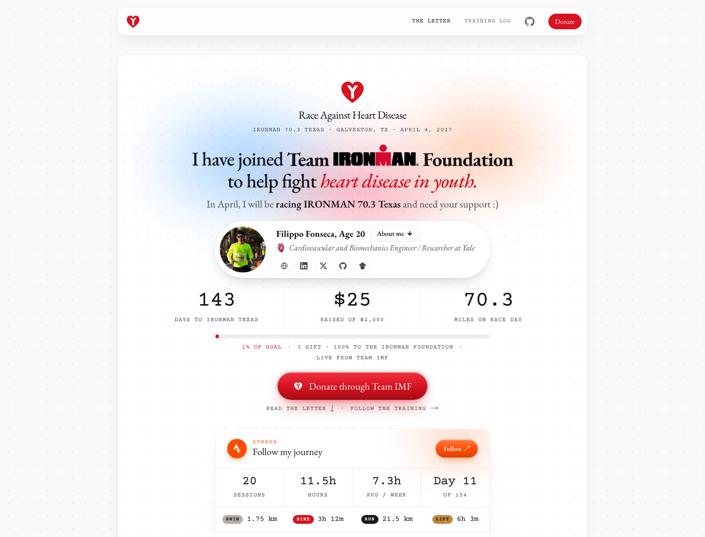
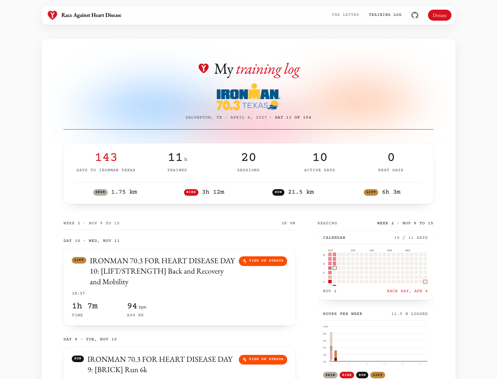
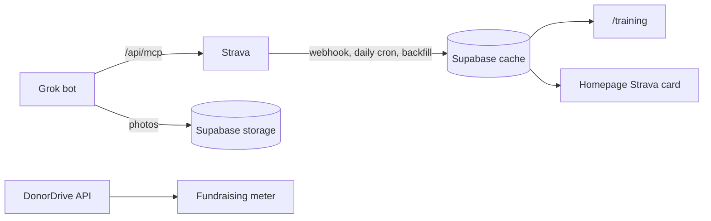

<p align="center">
  <a href="https://www.againstheartdisease.xyz">
    
  </a>
</p>

<p align="center">
  <a href="https://www.againstheartdisease.xyz"><strong>againstheartdisease.xyz</strong></a>
  &nbsp;·&nbsp;
  <a href="https://www.againstheartdisease.xyz/training">Training log</a>
  &nbsp;·&nbsp;
  <a href="https://ironmanfoundation.donordrive.com/participants/filippofonseca">Donate</a>
</p>

<p align="center">
  
  
  
  
  
  
  
</p>

---

On **April 4, 2027**, [Filippo Fonseca](https://filippofonseca.com) races **IRONMAN 70.3 Texas** in Galveston (1.2 mi swim, 56 mi bike, 13.1 mi run) with **Team IMF**, the charity team of [The IRONMAN Foundation](https://www.ironmanfoundation.org/).

The race is the demonstration. The message is prevention. Coronary heart disease is the leading cause of death in the world, and the habits that protect against it (daily movement most of all) are formed in childhood and tend to last a lifetime. This site makes that case in the form of a letter, publishes every training session as it happens, and points people to a foundation that gets young people moving.

> **Where the money goes.** Donations go to the IRONMAN Foundation through Team IMF, not directly to heart disease research. The bet is that the Foundation's work keeps more children from falling into patterns of inactivity, and that advocating for prevention through healthy habits and hard challenges spreads the message further as the total grows.

## What's here

<table>
  <tr>
    <td width="50%" valign="top">
      <a href="https://www.againstheartdisease.xyz"></a>
      <p><strong>The letter.</strong> The case for prevention, in Filippo's words, with every figure cited. It has a live fundraising meter, a Strava card with running totals, photo postcards, and the race drawn to scale.</p>
    </td>
    <td width="50%" valign="top">
      <a href="https://www.againstheartdisease.xyz/training"></a>
      <p><strong>The training log.</strong> Every swim, ride, run and lift from day 1 (Nov 2, 2026) to race day (day 154). It's retroactive only, with no plan: activity cards with photos, a calendar, weekly hours, cumulative time and heart rate.</p>
    </td>
  </tr>
</table>

### Highlights

- **Strava is the source of truth.** A webhook, a daily cron and a backfill script cache activities in Supabase. Visitors never hit Strava, and photos added after upload are picked up on the next sync.
- **Live fundraising.** The total, goal and donor count come straight from DonorDrive's public API and refresh every 10 minutes.
- **A Grok bot that logs training.** `/api/mcp` is a remote MCP server with 10 tools: overview, fundraising, list, log, update and delete activities, resync, and photo management. It writes to Strava, never directly to the database.
- **One accent colour.** A calm black and white page, with red reserved for the call to action and the headline, a soft gradient glow behind the hero, and a dot grid that parts around the cursor.
- **Respectful by default.** No tracking, no cookies, no analytics beyond the host's. and `prefers-reduced-motion` stills every animation.

## How it works



| Piece | Where |
| --- | --- |
| Copy, dates, links, cited stats | [`src/lib/site.ts`](src/lib/site.ts) |
| The letter | [`src/components/Letter.tsx`](src/components/Letter.tsx) |
| Training log page | [`src/app/training/page.tsx`](src/app/training/page.tsx) |
| Strava client, sync, webhook | [`src/lib/training/`](src/lib/training), [`src/app/api/strava/`](src/app/api/strava) |
| Fundraising (DonorDrive) | [`src/lib/fundraising.ts`](src/lib/fundraising.ts) |
| MCP server for the Grok bot | [`src/app/api/mcp/route.ts`](src/app/api/mcp/route.ts), [`src/lib/mcp/`](src/lib/mcp) |

Deeper docs:

- [`docs/TRAINING-LOG.md`](docs/TRAINING-LOG.md): design, data flow, sport buckets and setup.
- [`docs/MCP.md`](docs/MCP.md): connecting the Grok bot. Its system prompt is in [`docs/GROK-BOT-PROMPT.md`](docs/GROK-BOT-PROMPT.md).
- [`docs/ADMIN.md`](docs/ADMIN.md): the private `/admin` page.

## Run it locally

Needs **Node 22+**.

```bash
npm install
npm run dev
```

The letter renders without any configuration. The training log, fundraising meter and bot need a few environment variables in `.env.local`:

| Variable | What it does |
| --- | --- |
| `NEXT_PUBLIC_SUPABASE_URL`, `SUPABASE_SERVICE_ROLE_KEY` | Supabase project holding the `training` schema (migrations in [`supabase/migrations`](supabase/migrations)) |
| `STRAVA_CLIENT_ID`, `STRAVA_CLIENT_SECRET` | Strava API app, then `npm run strava:auth` to connect an athlete |
| `STRAVA_WEBHOOK_VERIFY_TOKEN`, `CRON_SECRET` | Webhook verification and the daily sync cron |
| `ADMIN_PASSWORD`, `ADMIN_SESSION_SECRET` | The private `/admin` page |
| `DONORDRIVE_PARTICIPANT_ID` | Live fundraising total (Filippo's is `5303`) |
| `MCP_TOKEN` | Bearer token for `/api/mcp` |
| `NEXT_PUBLIC_DONATE_URL` | Optional override for the Donate buttons |

Other scripts:

```bash
npm test                  # unit tests (node:test)
npm run lint              # eslint
npm run strava:backfill   # pull the whole training window from Strava
npm run strava:subscribe  # register the Strava webhook
```

## Design

- **Type:** EB Garamond for prose and headlines (italic for emphasis), Courier Prime for labels and figures, and Caveat for postcard captions.
- **Colour:** ink `#141414` on white, with red `#d8121f` as the one accent. Strava orange `#FC4C02` appears only inside the Strava card. Sport pills use the chart palette: SWIM grey, BIKE red, RUN black and LIFT ochre.
- **Texture:** a blurred blue, red and orange glow behind page headers, plus a dot grid (on the letter) that ripples and warms to red around the cursor.

## Sources

Every figure quoted on the page, with its primary source:

| Figure | Claim | Source |
| --- | --- | --- |
| ~34 sec | Interval between cardiovascular deaths in the US | [CDC](https://www.cdc.gov/heart-disease/data-research/facts-stats/index.html) |
| 19.8M | Annual cardiovascular deaths worldwide, about 32% of all deaths | [WHO](https://www.who.int/news-room/fact-sheets/detail/cardiovascular-diseases-(cvds)) |
| 1 in 4 | US children aged 6 to 17 who meet the 60 min/day activity guideline (24%) | [CDC](https://archive.cdc.gov/www_cdc_gov/healthyschools/physicalactivity/facts.htm) |
| 81% | Adolescents worldwide who are insufficiently active | [WHO](https://www.who.int/news-room/fact-sheets/detail/physical-activity) |
| 60 min / 150 min | Daily activity guideline for children and weekly guideline for adults; meeting it is associated with roughly 22 to 25% lower cardiovascular mortality | [AHA](https://www.heart.org/en/news/2022/07/25/getting-more-exercise-than-guidelines-suggest-may-further-lower-death-risk) |

If a number here is wrong or out of date, [open an issue](https://github.com/filippo-fonseca/race-against-heart-disease/issues). The whole point is to be held to it.

## Contributing

Issues and pull requests are welcome, especially corrections to sources, accessibility fixes, and anything that makes it easier for someone to fork this for their own race. If you do fork it, swap in your own story in `src/lib/site.ts`, your own Strava app and your own fundraising page.

## Trademarks

IRONMAN, IRONMAN 70.3 and the M-Dot logo are registered trademarks of World Triathlon Corporation. They appear on this site (`public/ironman-logo.png`, `public/ironman-703-texas.png`) only because the page fundraises as part of Team IRONMAN Foundation for IRONMAN 70.3 Texas. They are not this project's brand, and this project is not affiliated with or endorsed by IRONMAN. Strava is a trademark of Strava, Inc.

## License

[MIT](LICENSE). The letter's words are Filippo's. Reuse the code freely, and write your own letter.
